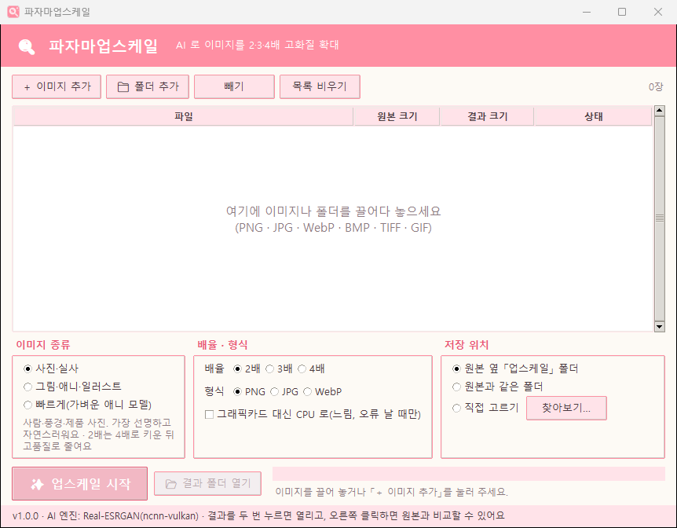

  

<h1 align="center">파자마업스케일 (PajamaUpscale)</h1>

  이미지를 <b>AI로 2배·3배·4배</b> 선명하게 키우는 윈도우 프로그램이에요. 
  그냥 늘리는 것과 달리 흐릿해진 선과 질감을 AI가 새로 그려 주고, 인터넷에 올리지 않고 이 컴퓨터 안에서만 처리해요.

  
  
  

  

---

## ⬇️ 받기

  <a href="https://github.com/hwangjinwook/PajamaUpscale/releases/latest"><b>👉 최신 버전 받으러 가기 (Releases)</b></a>

<table>
<tr><th nowrap>파일</th><th>설명</th></tr>
<tr><td nowrap><code>파자마업스케일.exe</code></td><td>프로그램 본체</td></tr>
<tr><td nowrap><code>engine\</code></td><td>AI 엔진(Real-ESRGAN)과 모델. exe 와 꼭 같은 폴더에 있어야 해요</td></tr>
<tr><td nowrap><code>README_사용설명서.txt</code></td><td>이 페이지와 같은 사용법</td></tr>
<tr><td nowrap><code>THIRD_PARTY_LICENSES.txt</code></td><td>함께 들어 있는 AI 엔진·라이브러리의 라이선스</td></tr>
</table>

## 🚀 실행하기

1. 위 링크의 **Assets** 에서 `PajamaUpscale_v버전.zip` 을 받아요(약 80MB).
2. 원하는 폴더에 **압축을 풀어요.** zip 창 안에서 바로 실행하면 `engine` 폴더를 찾지 못해요.
3. `파자마업스케일` 폴더의 `파자마업스케일.exe` 를 실행해요.

> 설치할 것도, 파이썬도, 인터넷 연결도 필요 없어요. 확대는 그래픽카드(Vulkan)로 해서 빨라요. 
> 폴더를 옮길 때는 **`파자마업스케일` 폴더를 통째로** 옮기세요. exe 만 옮기면 `engine` 폴더가 빠져서 확대가 안 돼요. 
> 「Windows의 PC 보호」 창이 뜨면 「추가 정보」 → 「실행」을 누르세요(디지털 서명이 없는 프로그램이라 나오는 안내예요).

## 📝 사용법

<table>
<tr><th nowrap>하고 싶은 일</th><th>방법</th></tr>
<tr><td nowrap>이미지 넣기</td><td>이미지나 폴더를 창에 <b>끌어다 놓기</b>, 또는 <b>＋ 이미지 추가</b> / <b>📁 폴더 추가</b>(하위 폴더까지). PNG·JPG·WebP·BMP·TIFF·GIF</td></tr>
<tr><td nowrap>이미지 종류</td><td><b>사진·실사</b>(가장 선명·자연스러움) / <b>그림·애니·일러스트</b>(선이 또렷한 그림) / <b>빠르게</b>(많은 장을 빨리, 그림용)</td></tr>
<tr><td nowrap>배율 · 형식</td><td>2배·3배·4배, PNG(투명 유지)·JPG(투명은 흰 바탕)·WebP</td></tr>
<tr><td nowrap>저장 위치</td><td>원본 옆 「업스케일」 폴더(기본) / 원본과 같은 폴더 / 직접 고르기</td></tr>
<tr><td nowrap>확대하기</td><td><b>✨ 업스케일 시작</b> → 장마다 진행률 표시. <b>■ 멈추기</b>로 언제든 멈추고, 끝난 결과는 남아요</td></tr>
<tr><td nowrap>결과 보기</td><td>결과를 <b>두 번 누르면</b> 열려요. <b>📂 결과 폴더 열기</b>로 탐색기에서 보기</td></tr>
<tr><td nowrap>원본과 비교</td><td>결과를 오른쪽 클릭 → <b>🔍 원본과 비교하기</b>. 가운데 선을 끌어 비교, 휠로 확대, 오른쪽 버튼으로 끌어 이동</td></tr>
<tr><td nowrap>목록 정리</td><td><b>빼기</b>(또는 <code>Delete</code>), <b>목록 비우기</b></td></tr>
</table>

### 💡 알아 둘 점

- 결과는 `원래이름_x4.png` 처럼 저장되고, 같은 이름이 있으면 `(2)`, `(3)` 을 붙여 **원본이나 먼저 만든 결과를 덮어쓰지 않아요.**
- 휴대폰 사진의 회전을 바로잡아 확대하고, 색 정보·해상도 정보는 결과에도 남아요. 투명한 PNG 는 투명한 채로 커져요.
- 움직이는 GIF·WebP 는 첫 장면만 확대해요.
- 결과가 약 4억 화소(가로세로 2만 화소 정도)를 넘으면 메모리가 모자랄 수 있어 미리 막아요. 배율을 낮춰 주세요.
- 그래픽카드 오류가 나면 **그래픽카드 대신 CPU 로**를 켜 보세요(많이 느려요).
- 설정은 exe 옆 `settings.json` 에 저장돼서 다음에 켜도 그대로예요.

## 📜 버전 기록

<table>
<tr><th nowrap>버전</th><th nowrap>배포일</th><th>내용</th></tr>
<tr><td nowrap><b>v1.0.0</b></td><td nowrap>2026-11-21</td><td>첫 버전. AI 확대(사진·그림·빠르게) 2·3·4배, 여러 장·폴더·끌어 놓기, PNG·JPG·WebP, 저장 위치, 진행률·멈추기, 원본 비교 창, 회전·색 정보·투명 유지</td></tr>
</table>
